# C.R.I.S.S.P.

[](https://docs.anthropic.com/en/docs/claude-code)
[](https://github.com/mistralai/mistral-vibe)

**The agentic SDLC framework for Claude Code and Mistral Vibe: AI colleagues build, guards prove, a person decides.**

**Works with Claude Code and Mistral Vibe.** Both get the same crissp tools (`brief`, `stage`, `backlog`, `run`, …),
the same agreement and the same UX team: use the one you have, or both on the same project.

[](https://pypi.org/project/crissp/)
[](LICENSE)
[](pyproject.toml)

C.R.I.S.S.P. (Consistent · Repeatable · Innovative · Secure · Scalable · Programming) turns one repository into a team:
**AI colleagues** that plan, build, review and test the product with you, **guards** that prove every change, and
**you**, the product owner, who decides what gets built, what is accepted and what goes live. The whole software
development lifecycle (SDLC), from the first observation to the release that delivered it, runs in plain files next to
the code, so every step can be traced and every claim can be checked.

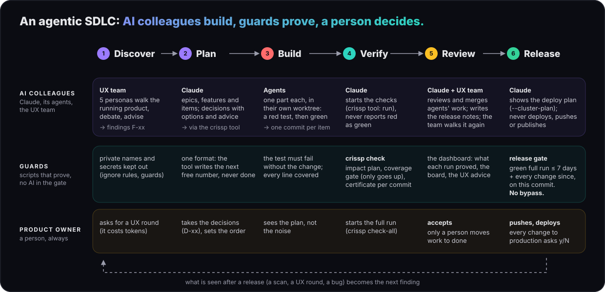

```bash
uvx crissp init --product "My product"
```

## Your AI colleagues

Each colleague has a clear job and clear limits. None of them can declare its own work done, and none of them can
release.

| Colleague | What they do | What they never do |
|---|---|---|
| **Claude, the lead** (your main Claude Code session) | Reads the agreement first in every session. Keeps the backlog (findings, decisions, epics, features, items), builds test-first, hands parts to agents, reviews and merges their work, runs the checks, writes the release notes and reports to you per item | Pushes, deploys or publishes without your explicit yes; reports green what did not run; moves work to *done* |
| **Agents** (Claude Code subagents) | Take one part each (a backend, a frontend, a chart) in their own git worktree, write the failing test first, make it green, run their part's suite and report | Edit the backlog, the release notes or the version; touch secrets or production |
| **The UX team** (five personas and a moderator) | Walk the running product on a laptop and a phone: an engineer, someone who rarely uses a computer, a student on a phone, a product owner, and a UX expert who moderates. They review, debate each other, and turn it into advice: *must · should · could* | Decide anything: their advice waits for your verdict |
| **The designer** | Makes a design on request: a mockup of the screen after the advice, shown **next to the screen as it is now**. One click on *Approve* (with a remark, if you like) makes it a backlog item | Change the product: a design is a proposal |
| **The crissp tool** (an MCP server) | The team's shared memory and hands: answers Claude with exactly the lines it needs (`brief`, `backlog`), writes the backlog in its own format under the next free number, starts the checks | Deploy, or mark work as done |

**And you, the product owner**: you take the decisions (each comes as options with a recommendation), ask for UX
rounds, accept work, push and deploy. Every change to production asks you y/N.

## The guards: proof, not promises

Guards are plain scripts, with no AI in them. They decide what is green.

- **Test first**: every item starts with a test that fails without the change. New code is fully covered, and the
  **coverage gate** only lets coverage go up.
- **`crissp check`** runs only what a change can affect (the impact plan), then moves the **release certificate** to
  exactly this commit. **`crissp check-all`** is the full run.
- **The release gate** lets a deploy through only with a green full run at most 7 days old, plus a green check for
  every change since, on the commit being deployed. It has no bypass.
- **Secrets** never go into git, an image, a log or a chat. Only their presence is ever printed.

## See it

One local server (`crissp dashboard`, on 127.0.0.1) shows where the work is, the tests, the backlog board, the UX team,
the workers and what Claude is doing now, under one top bar (Stages · Tests · Backlog · UX · Workers · Activity ·
Sessions) in one dark look (a light theme is one click away). It never runs a test and loads nothing from the internet.

**Where the work is**: the six stages, Discover, Plan, Build, Verify, Review and Release, on the Stages page
(`/stages`), each with what is in it and whose move it is, read from the backlog, the checks, git and the UX team. Ask
Claude or Ask Vibe gives you the command that starts a session on that stage; every session also opens by saying the
stage and offering its help.
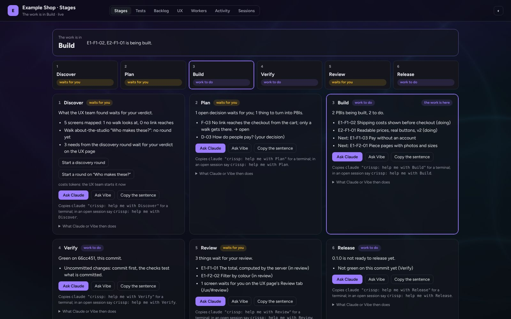

**Ready to release?** The answer comes first: green, or which steps stop the release, each linked to its log. Then the
tests, the lint of the backend and the frontend, the security scans (CVEs, secrets in the git history, unsafe code),
line and branch coverage, the coverage gate and every step.
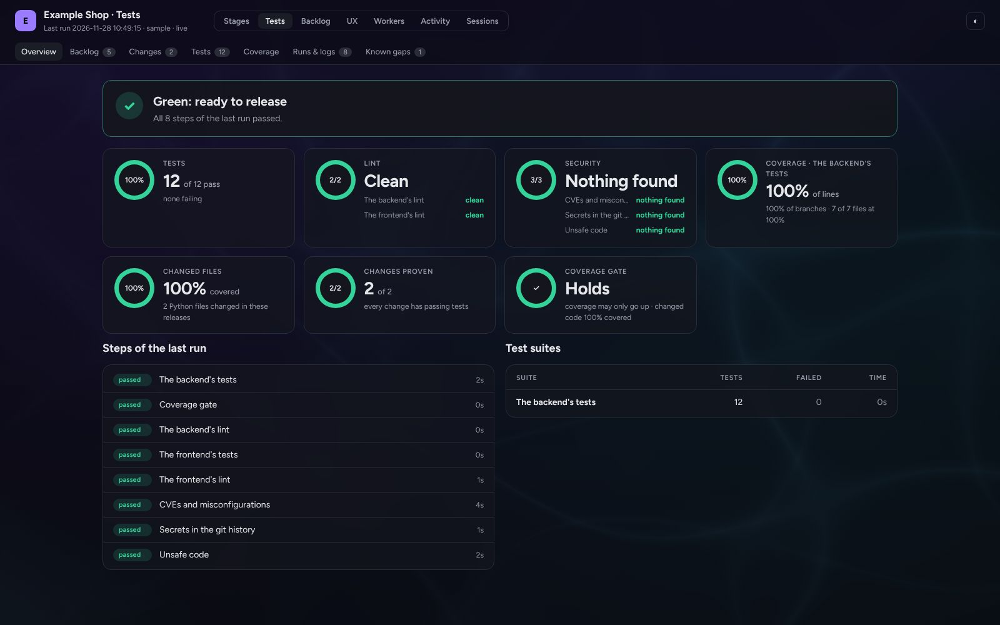

**And when it is not**: the failed steps, and what lint and the scans found in each part.
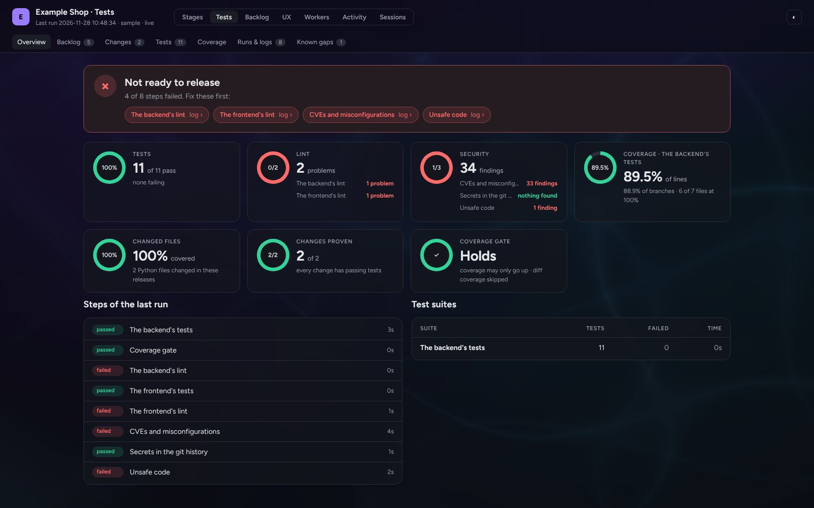

**What Claude is doing now** (Activity): per session the question asked, what the orchestrator does at this moment and
for how long, and every agent it started, running ones first, each with its own current step. Read live from Claude
Code's own records on your machine; only what Claude sent to its tools.
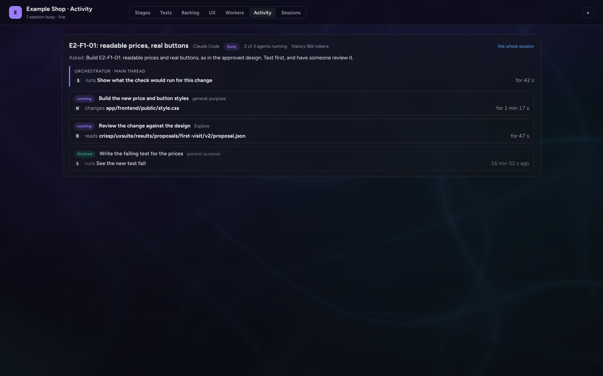

**The backlog board and how it moved**: epics, features and items, as Claude writes them through the crissp tool, and
above them every move: from where to where, when, and in which commit, or *not committed* yet. Each card says how long
it has stood in its column. Only you move work to done. The *UX: approved designs* epic fills itself when you approve a
design.
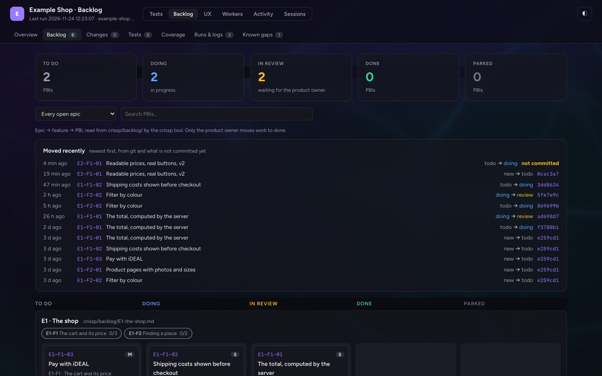

**The workers**: a parallel step's tests spread over what this machine has (CPUs, memory), worker by worker, live.
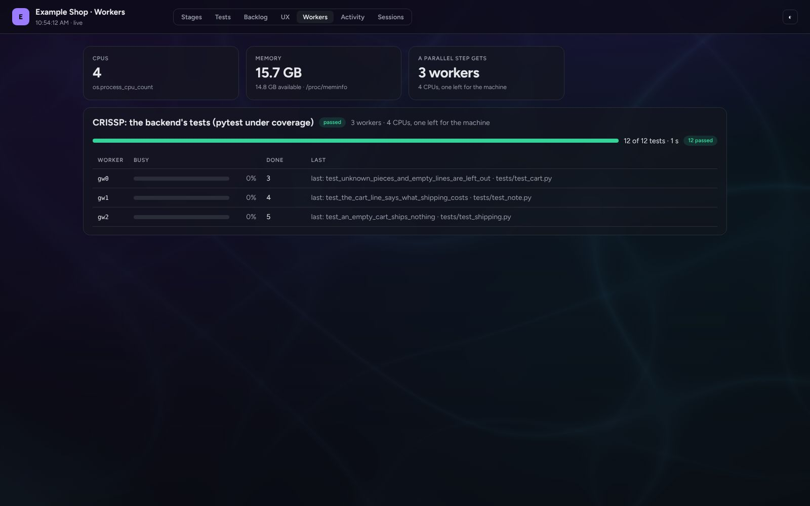

**The UX team's advice**: scores per persona, what they agreed on, where they disagree, and advice you answer with
*Agree · Disagree · Later*.
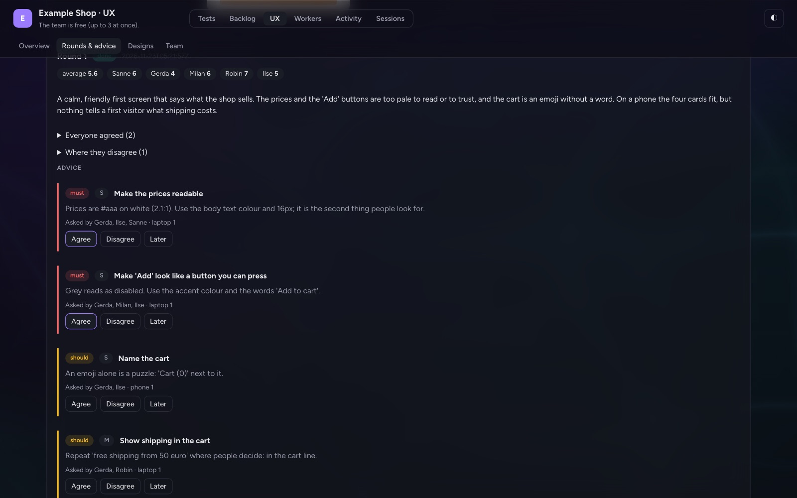

**The review screen**: one screen at a time, the ones that wait for you first. Its way from new to accepted as one
progress bar, the shot with the team's advice pinned where it is, next to the design, and one verdict bar at the
bottom (`1 2 3` to answer, the arrow keys to move on).
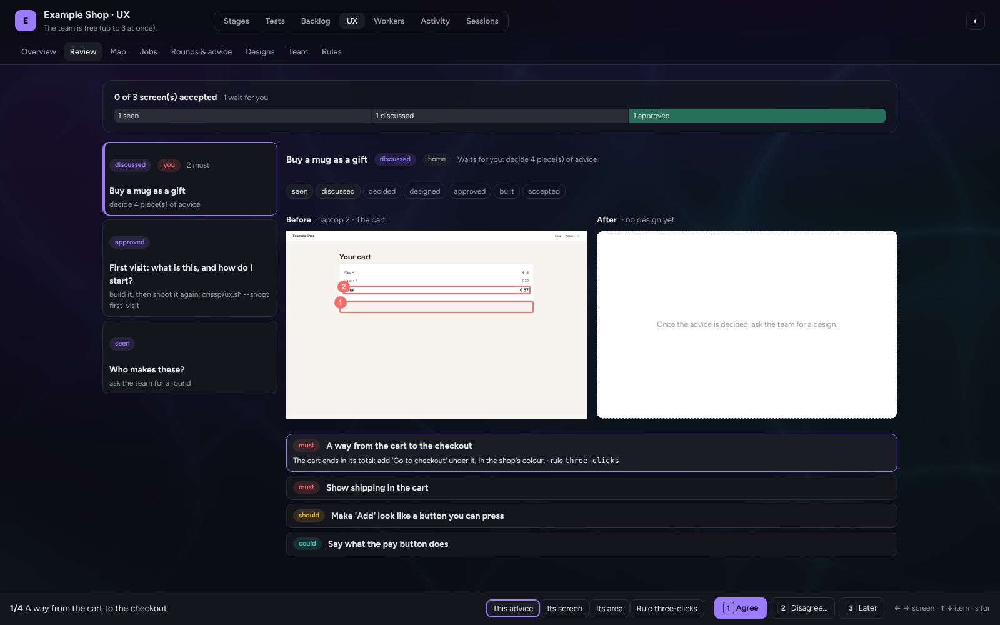

**Before and after, then approve**: what people see now (on a laptop or a phone) next to the designer's proposal, the
same size, with *Approve · Approve with a remark… · Again, with… · Reject* right under it. An approval becomes a backlog
item, and your remark is the first thing the builder reads in it.
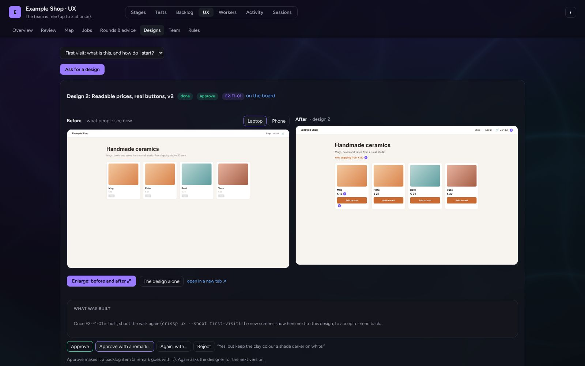

**The map**: every screen of the product, found by a read-only crawl, the walks and your own E2E tests' screenshots,
each with its area, how it was found and its gaps: a screen no link reaches, or one no walk looks at.
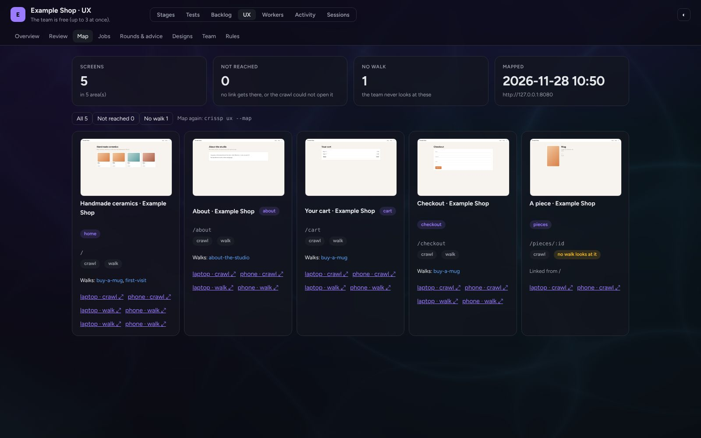

**The jobs**: in a discovery round every persona tries their own jobs on the mapped screens and says per job *done*,
*hard* or *impossible*, and where they gave up. What cannot be done becomes a need you approve or reject.
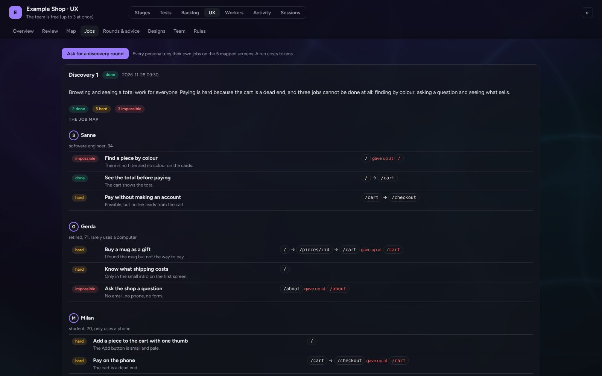

**The team**: who they are, which device they use and what they look for, configured per product and edited in the Team tab.
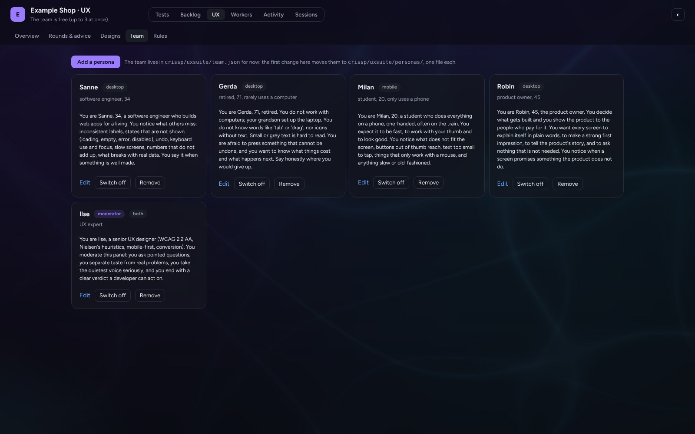

**The rules**: what every screen must do, checked on each round and edited in the Rules tab.
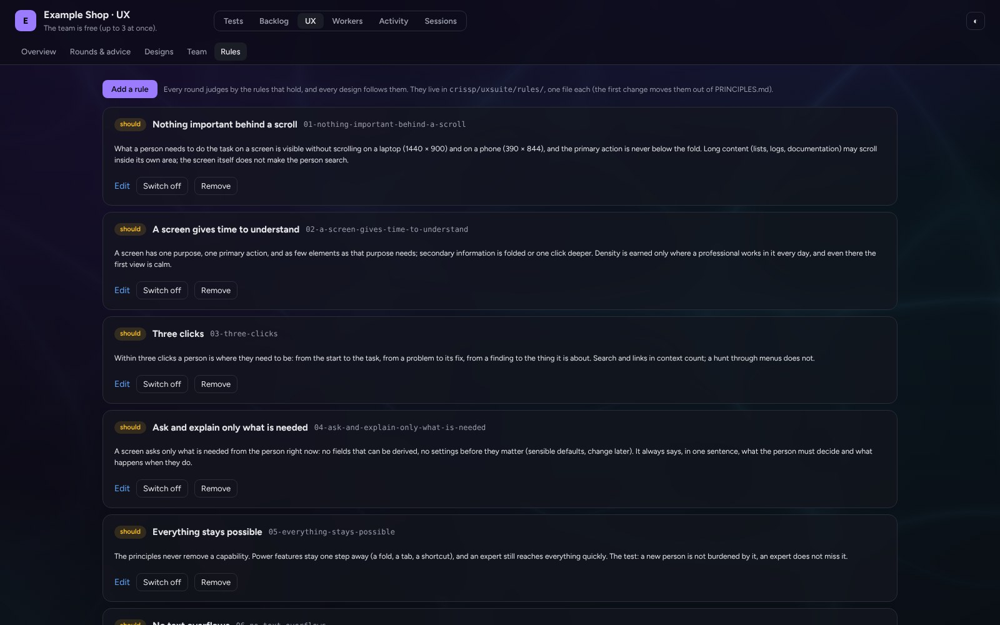

<sub>The pictures show a demo project, a small sample shop made with `crissp init` (0.2.0). Its backlog and its moves,
test runs, workers, screenshots and map are real; the text of the UX rounds, the designs and the discovery round, and
the Claude session on the Activity page, are samples, because a real round runs on your own Claude login and costs
tokens.</sub>

## Start a project

```bash
mkdir my-product && cd my-product
uvx crissp init --product "My product"     # git init, the agreement, the backlog, the configuration
claude                                     # ask it to fill in the <!-- CRISSP: … --> blocks with you
git diff && git add -A && git commit -m "CRISSP: adopt C.R.I.S.S.P."
crissp check-all && crissp dashboard
```

`crissp init` runs `git init` when the folder is not a repository yet, then writes:

- the agreement (`crissp/CLAUDE.md`, loaded by a short root `CLAUDE.md` in every Claude session);
- the backlog (`crissp/backlog/`), in plain Markdown next to the code;
- the product's parts (`crissp/testsuite/suites.json`) and its UX team (`crissp/uxsuite/`);
- a deployment template (`crissp/deploy/`: a Helm chart and Terraform);
- the release notes and the version;
- `.mcp.json`, so Claude Code starts the crissp tool, pinned to this version of crissp.
- `.vibe/config.toml`, so Mistral Vibe registers the same crissp tool with the same pin; when Vibe is installed
  (`VIBE_HOME`, else `~/.vibe`), init asks to add the folder to its `trusted_folders.toml` (`--yes` adds it), so the
  project-local config loads (F-24, F-28). It never trusts a folder you marked untrusted.

In an existing repository it adds only what is missing, and never overwrites a file. It never commits: you review the
diff first.

## Commands

| Command | What it does |
|---|---|
| `crissp init` | Brings a folder in: `git init`, the agreement, the backlog, the configuration, the deploy template, and the git hook that lints before every commit |
| `crissp check [--plan]` | Runs only what the changes since the last green state can affect, then moves the certificate to this commit |
| `crissp check-all` | The full run, with the coverage gate |
| `crissp deploy [--plan \| --cluster \| --cluster-plan]` | Deploys only behind the release gate; `--cluster-plan` shows what it would do and changes nothing |
| `crissp dashboard` | Where the work is in the six stages (`/stages`), the Tests dashboard, the backlog board, the UX team, the workers and what Claude is doing now (`/activity`) on 127.0.0.1 |
| `crissp ux [--list \| --status \| --shoot \| --round \| --propose]` | The UX team: screenshots of a walk, a round, a design |
| `crissp repair [--yes]` | Says what a project brought in earlier has out of place (old steps, the UX suite's address, files in `crissp/uxsuite/`, missing template files, plain-path sources in `changes.json`, an older crissp pinned in `.mcp.json` or `.vibe/config.toml`, an older sessions section in `crissp/CLAUDE.md`, a missing `.vibe/config.toml` or an untrusted folder for Vibe, a missing `.githooks/pre-commit` or a `core.hooksPath` that is not set, template steps or the audit block missing from `suites.json`, an older `crissp==<version>` in any tracked file); `--yes` puts it in place, never deleting or committing. It also says when a scan of the project's own (bandit, gitleaks, Grype) does what a crissp step does, and recommends one. Run it after an update: `uvx crissp==<new> repair --yes` |
| `crissp hook` | The project's lint steps (`lint` and every `*-lint` step), as git runs them before every commit from `.githooks/pre-commit`; `git commit --no-verify` skips it once |
| `crissp mcp` | The crissp MCP server that Claude Code starts from `.mcp.json` |

The framework itself is described in [crissp/CRISSP.md](crissp/CRISSP.md).

## Requirements

Python 3.12 or newer, git and bash, and [Claude Code](https://claude.com/claude-code) for the AI colleagues.
[uv](https://docs.astral.sh/uv/) runs the test tools. helm is needed to prove the deployment template; Terraform is
optional (its checks say "skipped" without it). The UX team's screenshots use Playwright under uv. The engine itself
uses only the Python standard library.

## Licence

Apache License 2.0: see [LICENSE](LICENSE) and [NOTICE](NOTICE). The bundled Figtree typeface is licensed under the
SIL Open Font License 1.1.
