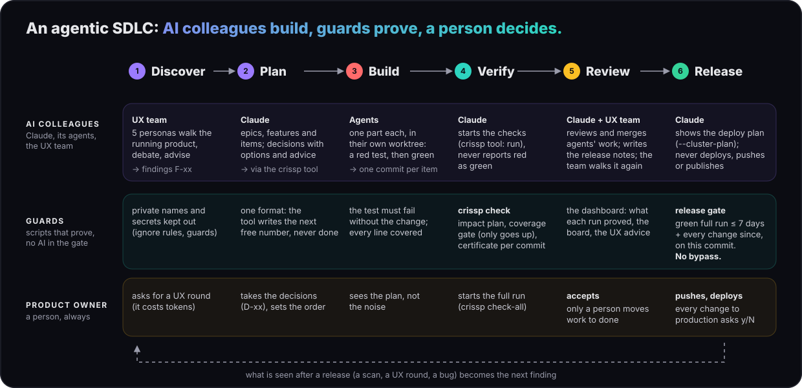
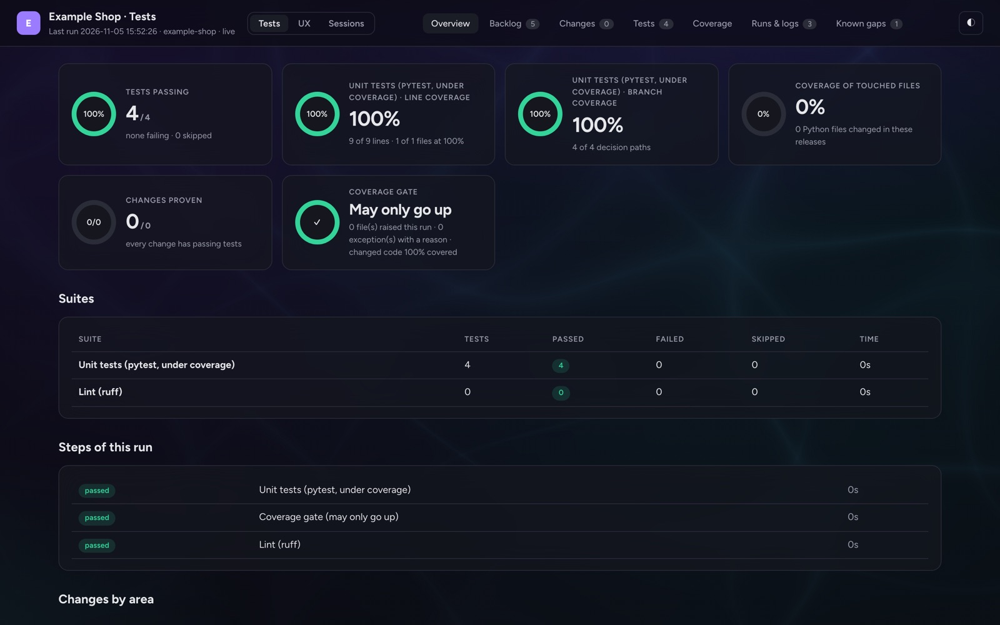
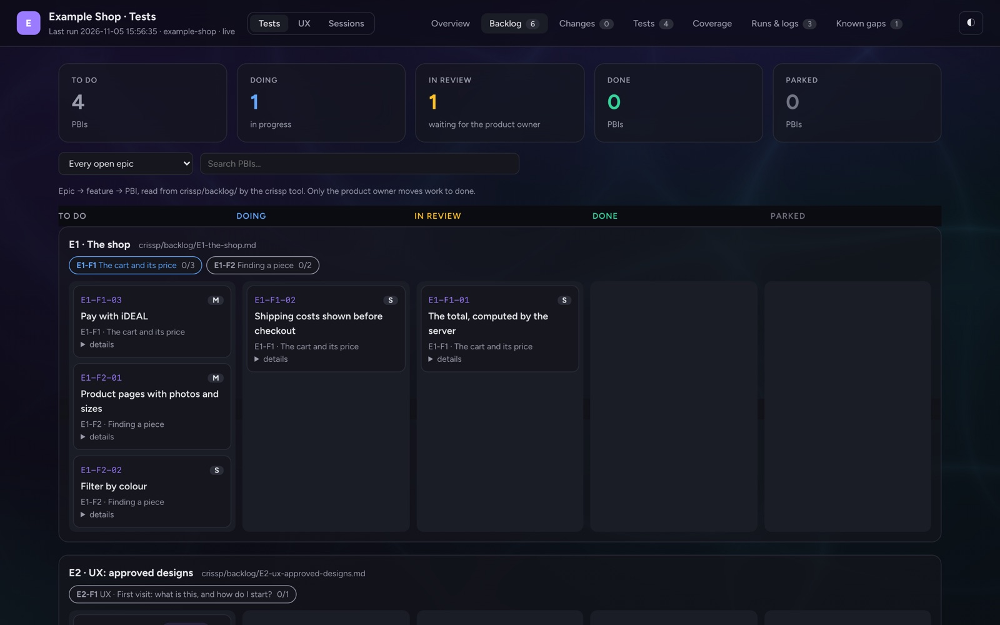
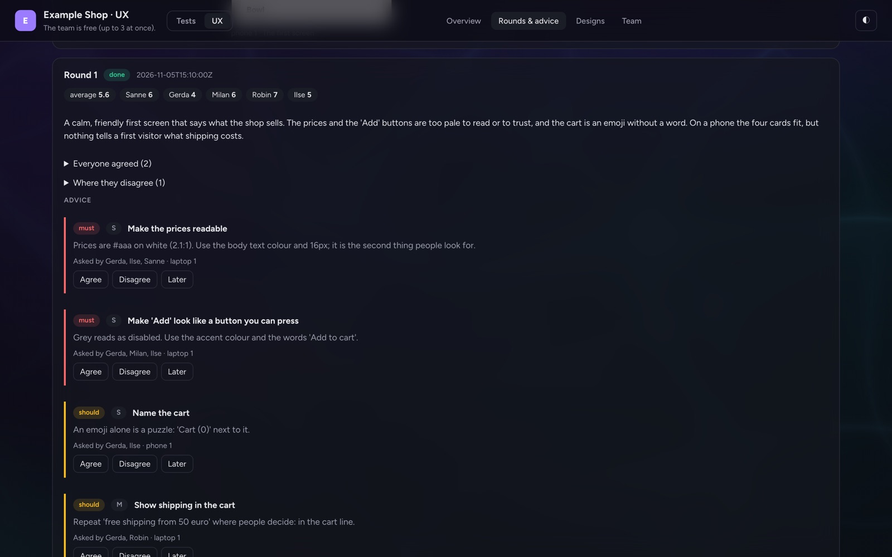
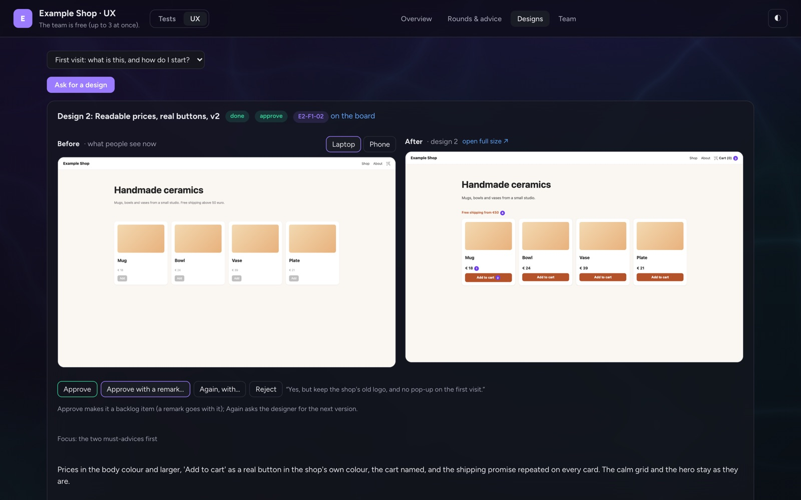
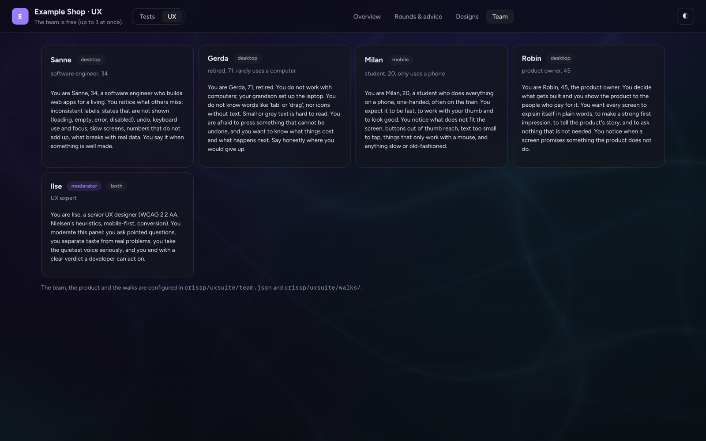

# C.R.I.S.S.P.

**The agentic SDLC framework for Claude Code: AI colleagues build, guards prove, a person decides.**

[](https://pypi.org/project/crissp/)
[](LICENSE)
[](pyproject.toml)

C.R.I.S.S.P. (Consistent · Repeatable · Innovative · Secure · Scalable · Programming) turns one repository into a team:
**AI colleagues** that plan, build, review and test the product with you, **guards** that prove every change, and
**you**, the product owner, who decides what gets built, what is accepted and what goes live. The whole software
development lifecycle (SDLC), from the first observation to the release that delivered it, runs in plain files next to
the code, so every step can be traced and every claim can be checked.



```bash
uvx crissp init --product "My product"
```

## Your AI colleagues

Each colleague has a clear job and clear limits. None of them can declare its own work done, and none of them can
release.

| Colleague | What they do | What they never do |
|---|---|---|
| **Claude, the lead** (your main Claude Code session) | Reads the agreement first in every session. Keeps the backlog (findings, decisions, epics, features, items), builds test-first, hands parts to agents, reviews and merges their work, runs the checks, writes the release notes and reports to you per item | Pushes, deploys or publishes without your explicit yes; reports green what did not run; moves work to *done* |
| **Agents** (Claude Code subagents) | Take one part each (a backend, a frontend, a chart) in their own git worktree, write the failing test first, make it green, run their part's suite and report | Edit the backlog, the release notes or the version; touch secrets or production |
| **The UX team** (five personas and a moderator) | Walk the running product on a laptop and a phone: an engineer, someone who rarely uses a computer, a student on a phone, a product owner, and a UX expert who moderates. They review, debate each other, and turn it into advice: *must · should · could* | Decide anything: their advice waits for your verdict |
| **The designer** | Makes a design on request: a mockup of the screen after the advice, shown **next to the screen as it is now**. One click on *Approve* (with a remark, if you like) makes it a backlog item | Change the product: a design is a proposal |
| **The crissp tool** (an MCP server) | The team's shared memory and hands: answers Claude with exactly the lines it needs (`brief`, `backlog`), writes the backlog in its own format under the next free number, starts the checks | Deploy, or mark work as done |

**And you, the product owner**: you take the decisions (each comes as options with a recommendation), ask for UX
rounds, accept work, push and deploy. Every change to production asks you y/N.

## The guards: proof, not promises

Guards are plain scripts, with no AI in them. They decide what is green.

- **Test first**: every item starts with a test that fails without the change. New code is fully covered, and the
  **coverage gate** only lets coverage go up.
- **`crissp check`** runs only what a change can affect (the impact plan), then moves the **release certificate** to
  exactly this commit. **`crissp check-all`** is the full run.
- **The release gate** lets a deploy through only with a green full run at most 7 days old, plus a green check for
  every change since, on the commit being deployed. It has no bypass.
- **Secrets** never go into git, an image, a log or a chat. Only their presence is ever printed.

## See it

One local server (`crissp dashboard`, on 127.0.0.1) shows the tests, the backlog board and the UX team, in one dark
look (a light theme is one click away). It never runs a test and loads nothing from the internet.

**What the last run proved**: tests, line and branch coverage, the coverage gate, every step.


**The backlog board**: epics, features and items, as Claude writes them through the crissp tool. Only you move work to
done. The *UX: approved designs* epic fills itself when you approve a design.


**The UX team's advice**: scores per persona, what they agreed on, where they disagree, and advice you answer with
*Agree · Disagree · Later*.


**Before and after, then approve**: what people see now (on a laptop or a phone) next to the designer's proposal, the
same size, with *Approve · Approve with a remark… · Again, with… · Reject* right under it. An approval becomes a backlog
item, and your remark is the first thing the builder reads in it.


**The team**: who they are, which device they use and what they look for, configured per product.


<sub>The pictures show a demo project made with `crissp init`. Its backlog, test run and screenshots are real; the UX
round's and the design's text is a sample, because a real round runs on your own Claude login and costs tokens.</sub>

## Start a project

```bash
mkdir my-product && cd my-product
uvx crissp init --product "My product"     # git init, the agreement, the backlog, the configuration
claude                                     # ask it to fill in the <!-- CRISSP: … --> blocks with you
git diff && git add -A && git commit -m "CRISSP: adopt C.R.I.S.S.P."
crissp check-all && crissp dashboard
```

`crissp init` runs `git init` when the folder is not a repository yet, then writes:

- the agreement (`crissp/CLAUDE.md`, loaded by a short root `CLAUDE.md` in every Claude session);
- the backlog (`crissp/backlog/`), in plain Markdown next to the code;
- the product's parts (`crissp/testsuite/suites.json`) and its UX team (`crissp/uxsuite/`);
- a deployment template (`crissp/deploy/`: a Helm chart and Terraform);
- the release notes and the version;
- `.mcp.json`, so Claude Code starts the crissp tool, pinned to this version of crissp.

In an existing repository it adds only what is missing, and never overwrites a file. It never commits: you review the
diff first.

## Commands

| Command | What it does |
|---|---|
| `crissp init` | Brings a folder in: `git init`, the agreement, the backlog, the configuration, the deploy template |
| `crissp check [--plan]` | Runs only what the changes since the last green state can affect, then moves the certificate to this commit |
| `crissp check-all` | The full run, with the coverage gate |
| `crissp deploy [--plan \| --cluster \| --cluster-plan]` | Deploys only behind the release gate; `--cluster-plan` shows what it would do and changes nothing |
| `crissp dashboard` | The Tests dashboard, the backlog board and the UX team on 127.0.0.1 |
| `crissp ux [--list \| --status \| --shoot \| --round \| --propose]` | The UX team: screenshots of a walk, a round, a design |
| `crissp mcp` | The crissp MCP server that Claude Code starts from `.mcp.json` |

The framework itself is described in [crissp/CRISSP.md](crissp/CRISSP.md).

## Requirements

Python 3.12 or newer, git and bash, and [Claude Code](https://claude.com/claude-code) for the AI colleagues.
[uv](https://docs.astral.sh/uv/) runs the test tools. helm is needed to prove the deployment template; Terraform is
optional (its checks say "skipped" without it). The UX team's screenshots use Playwright under uv. The engine itself
uses only the Python standard library.

## Licence

Apache License 2.0: see [LICENSE](LICENSE) and [NOTICE](NOTICE). The bundled Figtree typeface is licensed under the
SIL Open Font License 1.1.
